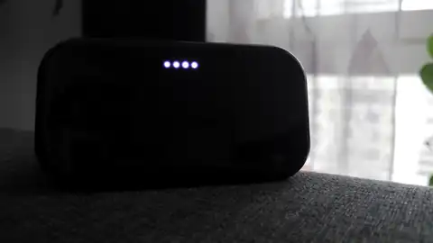
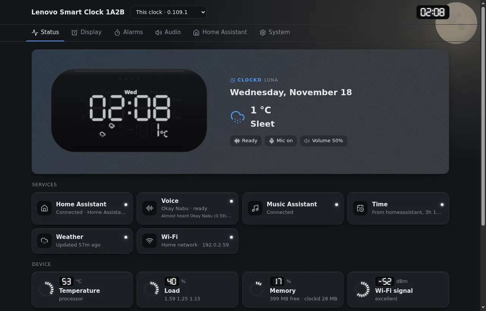
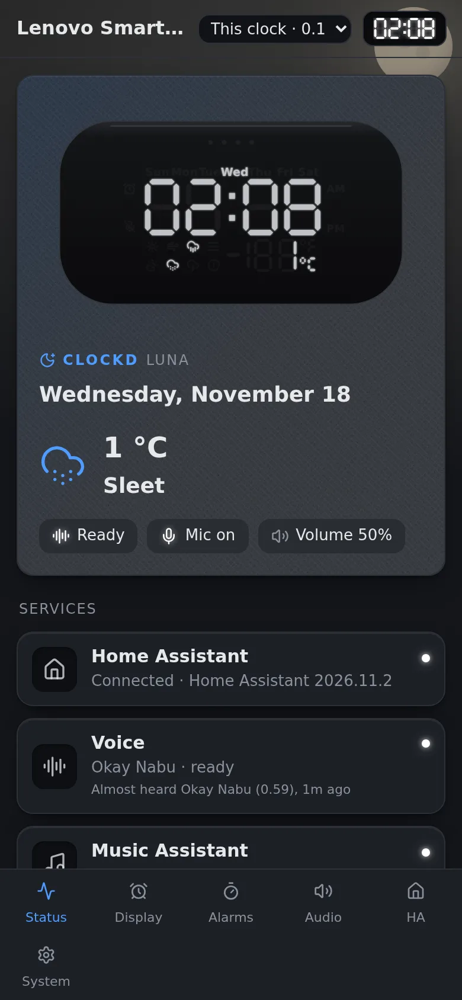
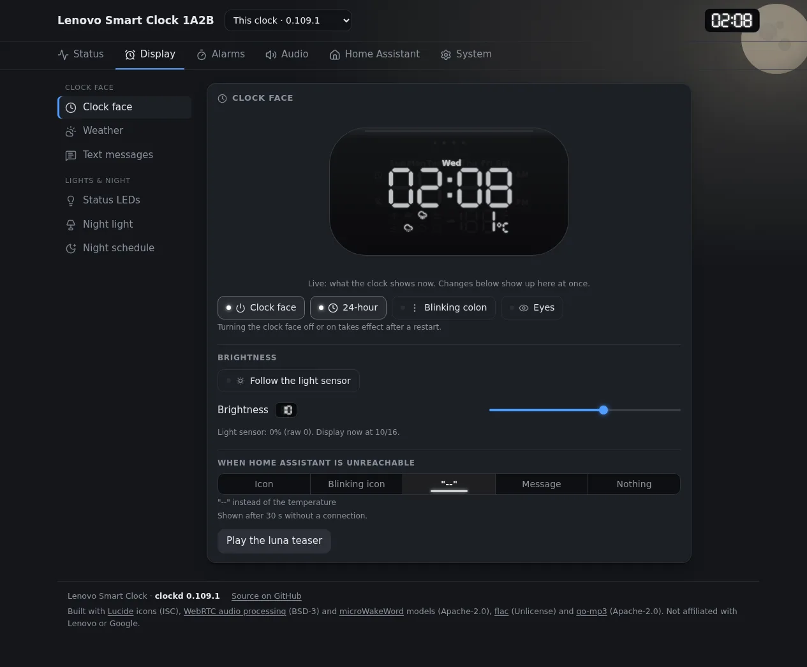
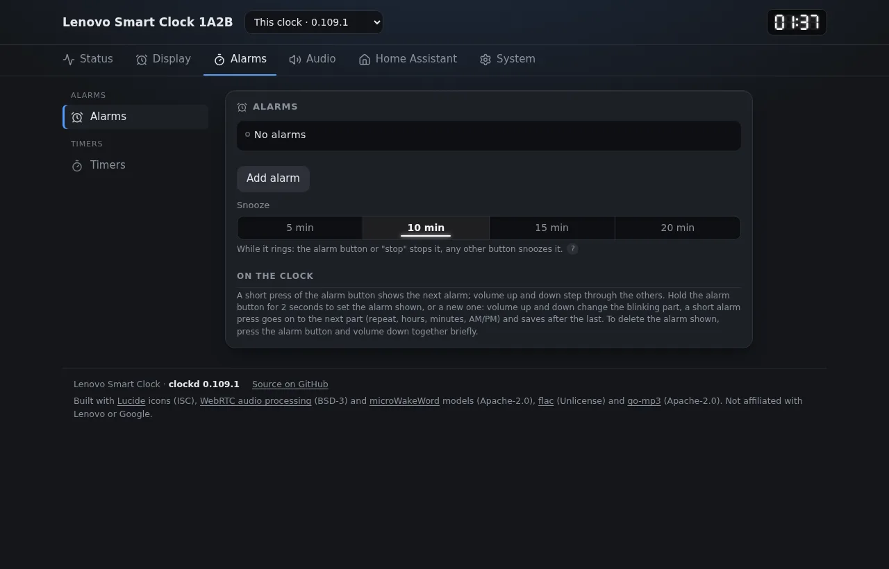
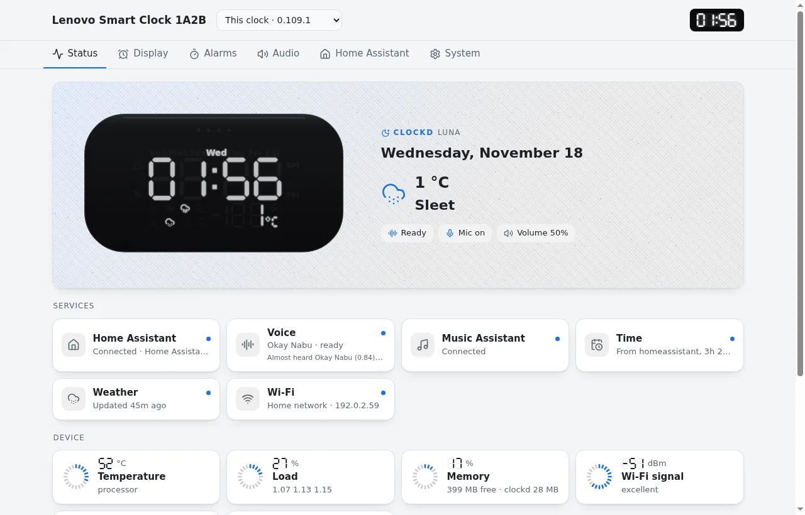
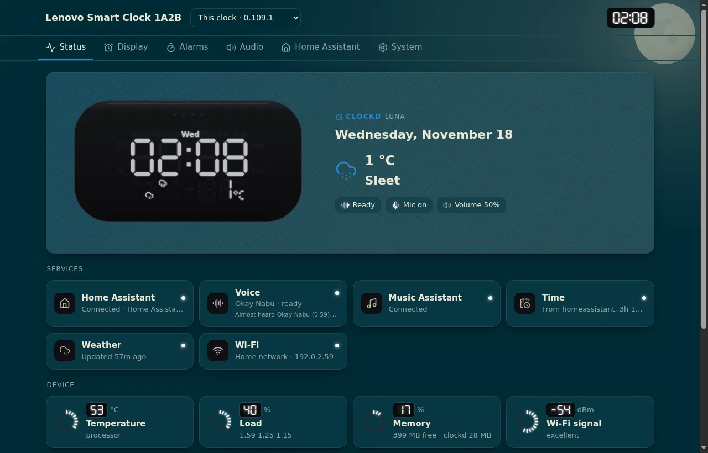
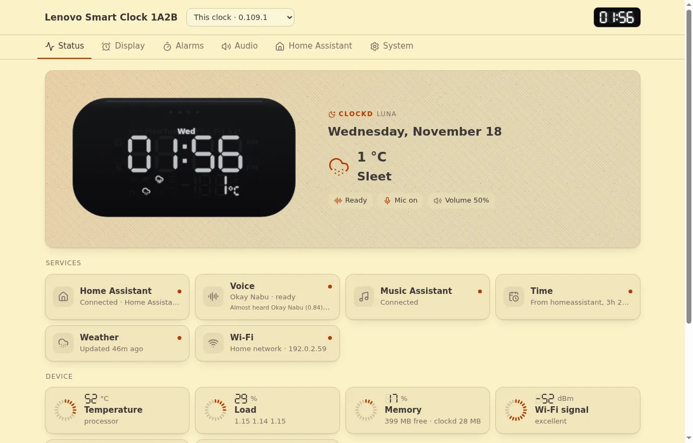
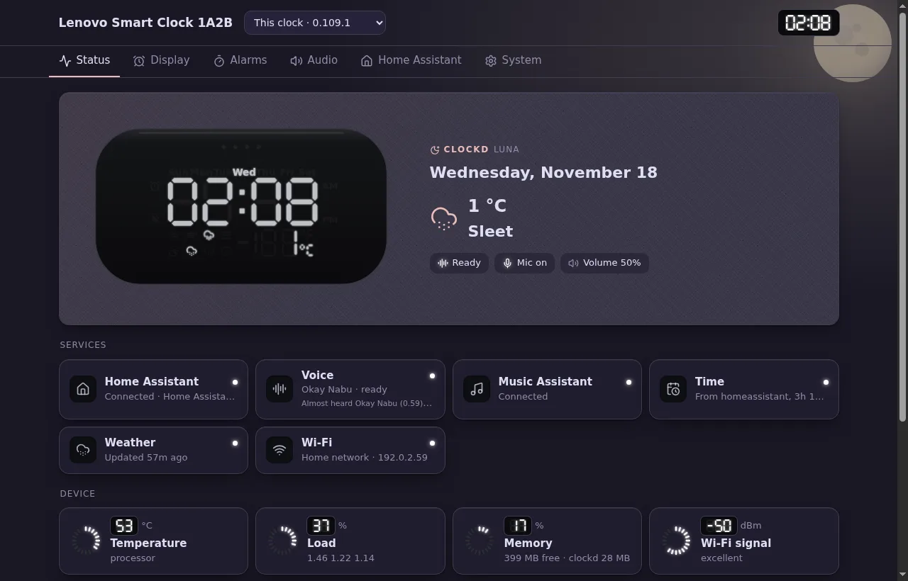
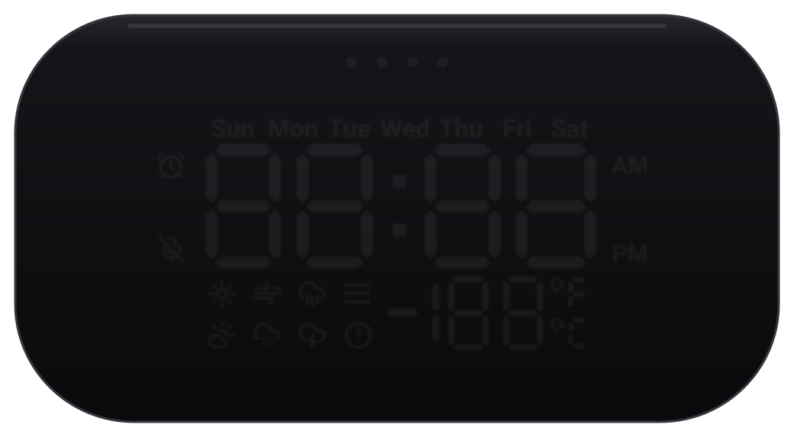

<p align="center">
  
</p>

<p align="center">
  
</p>

<p align="center">
  <b>A local Home Assistant voice satellite for the Lenovo Smart Clock Essential.</b><br>
  Runs without Google or Lenovo services; the wake word is detected on the clock.
</p>

<p align="center">
  Voice satellite · Music Assistant speaker · Clock face and lights · Web UI
</p>

---

clockd replaces the Google Assistant / Cast software on a rooted **Lenovo Smart Clock
Essential** (CD-4N341Y) with one static Go binary. "Luna" is Lenovo's own codename for the
device.

## Disclaimer

This is a personal project, inspired by a great device with lacking software, which would
otherwise end up in the recycling bin. I have tried to make sure I'm not stepping on anyone's
toes, since the Essential doesn't seem to have much interest around it at the moment. It
was, and is, a way to learn how to take advantage of LLMs effectively on a project of this
kind, and to take my mind off things in general. I have an extensive TODO list, so I'll
probably keep working on this as time goes by.

## Support

You can support this nonsense on [Ko-fi](https://ko-fi.com/pullasuti) if you feel like it.

> [!NOTE]
> The clock must be unlocked and rooted first: the companion repository **[luna-unlock](https://github.com/pullasuti/luna-unlock)**
> does that. Tested on the retail and the engineering firmware
> ([which clocks](DETAILS.md#which-clocks)).

## At a glance

- **Voice:** wake words detected on the clock, timers and announcements from Assist
- **Alarms:** kept on the clock, set from the buttons, the web UI or Home Assistant
- **Music:** a Music Assistant speaker with synchronised playback
- **Clock face:** time, weekday and weather, with little eyes while it listens
- **Night schedule:** dims the face and fades the night light
- **Local:** no internet needed; [what is switched off](DETAILS.md#local-first-what-changes-on-the-clock)

The full list: [Features](DETAILS.md#features). To get going: [Quick start](#quick-start).

## Web UI

Every setting lives in a web UI on the clock: no app, no account.

<table>
  <tr>
    <td width="75%"></td>
    <td width="25%"></td>
  </tr>
  <tr>
    <td align="center"><sub>Status: face, weather, services, device</sub></td>
    <td align="center"><sub>Phone layout</sub></td>
  </tr>
</table>
<table>
  <tr>
    <td width="50%"></td>
    <td width="50%"></td>
  </tr>
  <tr>
    <td align="center"><sub>Display: face preview, brightness</sub></td>
    <td align="center"><sub>Alarms</sub></td>
  </tr>
</table>

Sixteen colour themes, light and dark; a few of them:

<table>
  <tr>
    <td width="33%"></td>
    <td width="33%"></td>
    <td width="33%"></td>
  </tr>
  <tr>
    <td align="center"><sub>Light</sub></td>
    <td align="center"><sub>Solarized dark</sub></td>
    <td align="center"><sub>Gruvbox light</sub></td>
  </tr>
  <tr>
    <td width="33%"></td>
    <td width="33%"></td>
  </tr>
  <tr>
    <td align="center"><sub>Rosé Pine</sub></td>
    <td align="center"><sub>Dark (default)</sub></td>
  </tr>
</table>

## Quick start

**1. Unlock the clock** over a USB-A to USB-A cable with `luna-unlock.py` from **[luna-unlock](https://github.com/pullasuti/luna-unlock)** (its README has the
prerequisites). Then make a [backup](DETAILS.md#back-up-the-clock-first) before you
install anything.

**2. Install** from a Linux or macOS PC with
[adb](https://developer.android.com/tools/releases/platform-tools) and curl. Get the source
of the latest [release](https://github.com/pullasuti/luna-clockd/releases), unpack it, and
from its folder:

```sh
satellite/install-clock.sh --latest
```

It downloads and checks the signed package, shows which clock it found and asks before
going on. Add `--wifi "Home network"` to save your Wi-Fi at the same time.
[More options](DETAILS.md#setup-details-and-tips).

**3. Connect it.** Without Wi-Fi the clock opens a hotspot, `LenovoClock-XXXX`, and
scrolls "setup". Join it with a phone, press the button on top of the clock when asked,
and pick your network.

**4. Add it to Home Assistant.** It shows up under Settings › Devices & services as an
ESPHome device. The encryption key is in the clock's web UI.

That's it. Optionally, [lock the clock again](DETAILS.md#locking-the-clock-again): adb
closes, the web UI and ssh stay.

## Going back to stock

Hold the **alarm button** and **Vol-** for 12 s: the clock restarts into the stock
software. Hold them again for 12 s there to factory reset it.
[Details](DETAILS.md#setup-details-and-tips).

## More

- [docs/faq.md](docs/faq.md): common questions (is it Android? what can I install?)
- [DETAILS.md](DETAILS.md): backup, setup tips, updating, features, how it works,
  building, security notes, credits
- [docs/notes.md](docs/notes.md): engineering notes, measurements and dead ends
- [CHANGELOG.md](CHANGELOG.md): what changed

<p align="center">
  
</p>
<p align="center"><sub>A little easter egg (Display › Clock face)</sub></p>

## Licence

[Apache License 2.0](LICENSE). Bundled third-party parts keep their own licences
([Credits](DETAILS.md#credits)).

<sub>Not affiliated with Lenovo, Google, Nabu Casa or the Open Home Foundation. Lenovo's GPL
source release was used for reference only and is not included.</sub>
